<p align="center">
  
</p>

<p align="center">
  
</p>

---

# Hi, I'm Lakshya

```text
┌────────────────────────────────────────────────────────────┐
│                 ZERO PROGRAMMING MISSION LOG               │
├────────────────────────────────────────────────────────────┤
│ ROLE      : Computer Science Student                       │
│ STATUS    : Learning                                       │
│ OBJECTIVE : Build AI Systems                               │
│ METHOD    : Build → Break → Understand → Repeat            │
└────────────────────────────────────────────────────────────┘
```

---

## About Me

I'm a computer science student focused on **core software engineering**, **problem-solving**, and **building practical systems**.

I prefer understanding fundamentals deeply before moving to abstractions.


---

> Build things. Break them. Understand why they broke.
